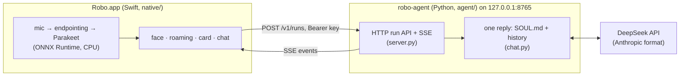

# Robo

Robo is a small animated robot face that lives on your macOS desktop, and a chatbot you talk to. Hold Ctrl+Q and speak, or type, and the answer is typed out as text in a Liquid Glass chat window. While it waits, Robo walks along the screen edges, looks around and reacts.

- **Voice is input only.** Robo listens through the microphone and answers in text. It never speaks.
- **It is a plain chatbot.** It has no tools: it can't browse, open files or read your mail, and it knows only what is said in the conversation. A fuller agent (tools, skills, memory, learning, school features) was removed on purpose and is kept on the `revamp` branch.
- **Privacy.** Speech becomes text on the Mac, and no audio leaves it. That text, and what you type, goes to DeepSeek; [its privacy policy](https://cdn.deepseek.com/policies/en-US/deepseek-privacy-policy.html) says data is stored in the People's Republic of China.

## Architecture



- **The app starts the service.** At launch, and again before a request if it has died, the app runs `uv run --project <checkout> robo-agent serve` and waits for `/health`. The service logs to `~/Library/Logs/Robo/agent.log`.
- **API.** `POST /v1/runs` starts a reply, `GET /v1/runs/{id}/events` streams it as Server-Sent Events, `POST /v1/runs/{id}/stop` cancels it, and `GET /health` needs no key. Everything else needs `Authorization: Bearer <server key>`.
- **Nothing is remembered for long.** History is kept per session in the service's memory, the last 100 messages, and is lost when the service restarts. The session id changes each day. The app's transcript is in memory too.
- **The plug for a future harness** is `chat.execute` in `agent/robo_agent/chat.py`: anything that emits `message.delta` and ends a run the same way works with the app.
- **Pure core, thin shell.** Every decision in the app is a plain function given the current time that returns what to do: the face's mood, where the pet walks, how fast the reply types. Windows, audio and the network are a thin layer around them, so most behaviour is tested without a screen, a clock or a microphone.

## Setup

You need an Apple silicon Mac on **macOS 26** or newer, the Swift 6.2 toolchain (Xcode 26 or its Command Line Tools), [uv](https://docs.astral.sh/uv/) and a DeepSeek API key.

```bash
git clone <this repo> robo && cd robo

# 1. Build and install the app. Sign with a stable identity, or macOS asks for the
#    microphone and Screen Recording again after every rebuild (unsigned = ad hoc).
ROBO_SIGN_IDENTITY="<your code-signing identity>" native/bundle.sh ~/Applications/Robo.app

# 2. The chat service's Python environment.
uv sync

# 3. The speech model, once. The app reads it from the Hugging Face cache and never downloads it.
uvx --from huggingface_hub hf download istupakov/parakeet-tdt-0.6b-v2-onnx

# 4. Your DeepSeek key: pasted at a hidden prompt (or piped on stdin), saved 0600.
~/Applications/Robo.app/Contents/MacOS/robo key set deepseek
~/Applications/Robo.app/Contents/MacOS/robo key status            # says only "set" / "not set"

# 5. The service's settings, the server key and the login item, then start Robo.
~/Applications/Robo.app/Contents/MacOS/robo setup
open ~/Applications/Robo.app
```

- Without the speech model, voice input reports that it is missing and typing still works.
- `robo setup` must be run from the installed `.app` (it refuses a bare binary). It writes `~/.local/share/robo/agent/config.json`, creates the server key and writes the `ai.robo` LaunchAgent that starts the app at login. Running it again keeps what you set.
- The service reads `agent/SOUL.md`, the persona, from the checkout the app was built in, on every request. There is no install step.

## Commands

| Command | What |
|---|---|
| `robo` | The app |
| `robo setup` | See above |
| `robo key set deepseek`, `robo key status` | Store the API key, or say whether it is set |
| `robo chat` | A text-only client for the same API; starts the service if it is not up |
| `robo voice-eval` | Scores the voice pipeline with macOS voices or your own recordings |

## Features

- **Push to talk.** Hold Ctrl+Q to talk. A tap listens for one sentence, which ends after 3 s of silence. If the key can't be registered, Robo wakes when you say its name instead.
- **Speech recognition** on the Mac: Parakeet TDT 0.6B v2 (int8, English only) on ONNX Runtime, on the CPU, with ONNX Runtime's telemetry turned off.
- **Follow-up window.** For 15 s after a reply has finished typing you can answer without the key, with a sentence of two words or more.
- **Chat window.** Typed and spoken requests open a Liquid Glass chat (520×640, centred on the main display) with bubbles and Copy on Robo's replies. Return sends, Shift+Return adds a line. It closes with its close button, on "close the chat", or with Esc in its text box.
- **Typed replies.** Markdown, tables and LaTeX (`$..$`, `$$..$$`, `\(..\)`, `\[..\]`, typeset with SwiftMath), about 55 characters a second, never far behind the stream.
- **Mood tags.** A hidden `[[feel:x]]` at the start of a reply sets the face's expression.
- **Adaptive glass.** Robo samples a small picture of the screen behind its glass, leaving out its own windows, and turns the glass light over dark areas and dark over light ones. This needs the Screen Recording permission; without it the look is the system's.
- **The pet.** A white disc with soft graphite features. It rests, drifts to a wall of the main display and bounces a little there; when called it walks to the nearest side or corner and waits. The right-click menu has Type, Stay and Quit.
- **Accessibility.** VoiceOver labels and announcements, and Reduce Motion, Reduce Transparency and Increase Contrast honoured.

## Repository layout

| Path | What |
|---|---|
| `native/Sources/RoboCore` | Pure logic: the service client and its event stream, the feeling filter, the mind, the roamer, the typewriter, the shade, LaTeX extraction, the transcript |
| `native/Sources/RoboVoice` | Microphone, resampling, endpointing, mel features, Parakeet on ONNX Runtime, `robo voice-eval` |
| `native/Sources/RoboSystem` | The service's files, keys and process (`Agent.swift`), `robo setup` (`Setup.swift`) |
| `native/Sources/RoboUI` | The panel, face, card, chat, glass, backdrop sampling, hotkey, app launch (`Launch.swift`) |
| `native/Sources/robo` | Entry point and command line |
| `native/Vendor` | Microsoft's ONNX Runtime Swift bindings, pinned to the 1.30.0 pod |
| `agent/robo_agent` | The chat service: `server.py` (HTTP API), `chat.py` (one reply), `config.py`, `cli.py` |
| `agent/SOUL.md` | The persona |
| `tests/` | pytest: the real service and client against a fake DeepSeek on loopback (`test_chat.py`) |
| `docs/` | A newcomer's guide, a technical deep dive, and speech and motion notes |

## Build and test

```bash
# Swift app
native/test.sh                                      # Swift Testing suite; use this, not `swift test`
native/test.sh -c release -Xswiftc -enable-testing  # also in release: some concurrency bugs only show there
ROBO_FACE_SHEET=<dir> native/test.sh --filter FaceSheet   # a contact sheet of every expression

# Chat service (from the repo root)
uv sync
uv run pytest -q && uv run ruff check agent tests
```

- **A test copy away from the live service:** `open -n --env ROBO_AGENT_URL=http://127.0.0.1:9 --env ROBO_NO_VOICE=1 ~/Applications/Robo.app`. With `ROBO_AGENT_URL` set the app does not start its service.
- **CI** (`.github/workflows/tests.yml`) runs `native/test.sh`, `pytest` and `ruff` on `macos-26`, for pushes to and pull requests into `master`.

## Workflow

Work goes on `dev`. A pull request from `dev` into `master` runs CI, and it is merged when CI is green; `master` is what the laptops run. Commit in small, named steps, and push often.

## Further reading

- [docs/newcomer-guide.md](docs/newcomer-guide.md): the project explained for someone new to Swift and app development.
- [docs/technical-deep-dive.md](docs/technical-deep-dive.md): every technique used, why it was chosen and what it costs.
- [docs/backend-recommendations.md](docs/backend-recommendations.md): speech and motion measurements, and what to try next.

## Known limits

- **Spaces and full screen** have not been checked on a real Mac.
- **Hotkey clashes** with another app over Ctrl+Q are not detected.
- **A noisy room** can fill the follow-up window, or keep a request open for up to 2 minutes, and that text goes to DeepSeek too.
