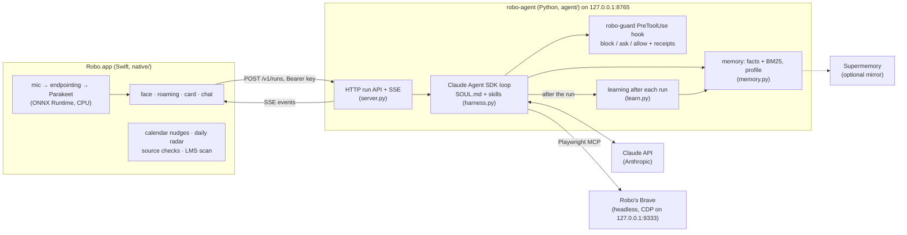

# Robo

Robo is a small animated robot face that lives on your macOS desktop and acts as a voice front end for a local AI agent. You hold Ctrl+Q and talk, Robo turns your speech into text on the Mac, hands it to its agent, and the answer streams back as text typed out in a Liquid Glass chat window. While it waits, Robo walks along the screen edges, looks around and reacts.

Two ideas shape the project:

- **The pet is only the interface.** Speech recognition, the face, windows and reminders run inside the Robo app. All reasoning and tool use (browser, terminal, files) happens in a separate agent process, `robo-agent`, which Robo reaches over loopback HTTP.
- **Voice is input only.** Robo listens through the microphone and answers in text. It never speaks.

## Architecture



- **The app starts the agent.** At launch, and again before a request if it has died, the app runs `uv run --project <checkout> robo-agent serve` and waits for `/health`. The service logs to `~/Library/Logs/Robo/agent.log`. The app also starts Robo's own headless Brave on `127.0.0.1:9333`, and the agent drives it through Playwright MCP over CDP.
- **Agent protocol.** A request is `POST /v1/runs` with `Authorization: Bearer <server key>`. Robo follows the run's Server-Sent Events: text deltas, tool calls, approval requests, usage and the end of the run. `/approval` answers an ask, `/stop` cancels a run, and `/health` needs no key.
- **Everything the agent keeps** is in `~/.local/share/robo/agent/` (folder 0700, key files 0600): `config.json` (written by `robo setup`), `api_key`, `supermemory_key`, `server_key`, `sessions.json`, `memory/`, `skills-learned/`, `learning.jsonl`.
- **Pure core, thin shell.** Every decision in the app is a plain function given the current time that returns what to do: the face's mood, where the pet walks, which reminder fires, whether a card may interrupt you. Windows, audio and the network are a thin layer around them, so almost all behaviour is tested without a screen, a clock or a microphone.

## Setup for a new user

You need an Apple silicon Mac on **macOS 26** or newer, the Swift 6.2 toolchain (Xcode 26 or its Command Line Tools), [uv](https://docs.astral.sh/uv/), Node.js (the agent starts Playwright MCP with `npx`), Brave Browser (for school sites) and an Anthropic API key.

```bash
git clone <this repo> robo && cd robo

# 1. Build and install the app. Sign with a stable identity, or macOS asks for the
#    microphone and Screen Recording again after every rebuild (unsigned = ad hoc).
ROBO_SIGN_IDENTITY="<your code-signing identity>" native/bundle.sh ~/Applications/Robo.app

# 2. The agent's Python environment.
uv sync

# 3. Your Anthropic key: pasted at a hidden prompt (or piped on stdin), saved 0600.
~/Applications/Robo.app/Contents/MacOS/robo key set anthropic
~/Applications/Robo.app/Contents/MacOS/robo key set supermemory   # optional
~/Applications/Robo.app/Contents/MacOS/robo key status            # says only "set" / "not set"

# 4. Agent settings, server key, login item and Obsidian vault.
~/Applications/Robo.app/Contents/MacOS/robo setup --moodle https://moodle.your-school.edu

# 5. Sign in to Outlook, Teams and Moodle once in Robo's Brave, then start Robo.
~/Applications/Robo.app/Contents/MacOS/robo signin
open ~/Applications/Robo.app
```

- **The speech model is not downloaded by the app.** It reads NVIDIA Parakeet TDT 0.6B v2 from the Hugging Face cache, `~/.cache/huggingface/hub/models--istupakov--parakeet-tdt-0.6b-v2-onnx` (the snapshot that `refs/main` names, with `encoder-model.int8.onnx`, `decoder_joint-model.int8.onnx` and `vocab.txt`). Download that repository into the cache once, for example with the Hugging Face CLI. Without it, voice input reports that the model is missing; typing still works.
- **`robo setup`** must be run from the installed `.app` (it refuses a bare binary). It writes `~/.local/share/robo/agent/config.json` (port 8765, model `claude-sonnet-5-5`, `approvals`, vault, Moodle address, the path of this `robo` and of `uv`, `learn`), creates the server key, writes the `ai.robo` LaunchAgent that starts the app at login, and creates the vault in `~/Documents/Robo`. Running it again keeps what you set and changes nothing else.
- **No install step for the agent.** The service reads `agent/SOUL.md` and `agent/skills/` from the checkout the app was built in and fills their placeholders from `config.json` on every run. Editing them changes the next run.

## Features

### Voice
- Audio is captured at 16 kHz in 80 ms frames. A loudness gate (2.5× the room's noise floor, never below 0.008 RMS) decides which frames count as speech, and a short pre-roll keeps the start of a word.
- **Push to talk** is Ctrl+Q, registered with Carbon `RegisterEventHotKey` (no Accessibility permission needed). Hold it to talk. A tap listens for one sentence, which ends after 3 s of silence. If the key can't be registered, Robo wakes when you say its name instead.
- Speech becomes text on the Mac with Parakeet TDT 0.6B v2 (int8) on ONNX Runtime, on the CPU only, with ORT's telemetry turned off. No audio leaves the machine.
- **Follow-up window.** For 15 s after a reply has finished typing you can answer without the key. Only a sentence that is clearly read-only (a question, or "show / read / explain ...") is taken there, and it needs two words or more. Anything else is refused with "Hold Ctrl+Q and say that again: without the key I only answer questions.", and the reply you were reading stays.

### Chat and card
- **Chat window.** Typed, spoken and digest requests open a Liquid Glass chat (about 520×640, centred on the main display) with bubbles, an empty state, "jump to latest" and Copy on Robo's bubbles. The text box grows to 5 lines: Return sends, Shift+Return adds a line, and Send is disabled while the box is empty. It closes on "close the chat" or Esc in its text box. The right-click menu's 💬 Type opens it for typing (so does a click on the face when voice input is off).
- **The pet's card** keeps the quick things: the menu, "listening", Allow/Deny and nudges. Its header shows an AGENT light (the agent's `/health`: one miss amber, two red), a MIC light and the model.
- **Typing.** Replies are typed at about 55 characters a second and never fall more than a few seconds behind the stream. Each tick renders the shown prefix as Markdown with open marks closed, so a half-typed `**` never flashes.
- **Mood tags.** A hidden `[[feel:x]]` at the start of a reply sets the face's expression before the first word appears, even when the tag arrives split across chunks.
- **LaTeX** (`$..$`, `$$..$$`, `\(..\)`, `\[..\]`) is taken out before the Markdown parse and typeset with SwiftMath, in two inks so it stays legible when the glass flips.
- **Adaptive glass.** Robo samples a 16 px picture of the screen behind its glass (ScreenCaptureKit, its own windows left out) and turns the glass light over dark areas and dark over light ones, with hysteresis and easing. This needs the Screen Recording permission; without it the look is the system's.
- **Accessibility.** VoiceOver labels and announcements, Allow/Deny reachable by keyboard (Tab between them), and Reduce Motion, Reduce Transparency and Increase Contrast honoured.

### The pet
- **Face.** A white disc (112 pt inside a 128×128 view) with ink features in the mood's hue, at 4.5:1 contrast or more at every hue. Features move on springs; blinks and glances come from a seeded random generator, so motion is reproducible in tests.
- **Roaming.** It rests, drifts to a wall of the main display and bounces a little there. When called it walks to the middle of the nearest side or to a corner and waits. A mouse press beats Stay, Stay beats a call, a call beats a drop, a drop beats sleep, and sleep beats wandering.
- **Window.** The panel never takes the keyboard, and its transparent margin passes clicks through.

### The agent (`robo-agent`)
- **Loop.** The Claude Agent SDK with `claude-sonnet-5-5`, the persona `agent/SOUL.md` and the 12 skills in `agent/skills/school/` (digest, mail, Teams, Moodle, posts, timetable, plan, quiz, ledger, notes, make, brain). Tools: Bash, Read, Write, Edit, Glob, Grep, WebSearch, WebFetch, Skill, the browser (Playwright MCP) and Robo's memory.
- **robo-guard** (`agent/robo_agent/guard.py`) is a PreToolUse hook on every tool call. It **blocks** the agent's own setup and keys, graded work (Moodle quiz attempts, assignment submissions, forum posts, raw JavaScript on school sites) and remote images or active HTML in notes. It **asks** before irreversible steps (`rm`, `sudo`, `git push`, Send/Reply/Delete clicks, Enter on a mail page, uploads). An error inside the hook denies the call. After each state-changing step it writes a receipt to `~/.local/share/robo/receipts.jsonl`, so the app can show "✓ sent · host" or "⚠ unverified" under a claim.
- **Approvals.** `approvals` in `config.json` is `"off"` for a new setup: the guard's asks are allowed and only its blocks stop the agent. With `"manual"` each ask reaches the card as Allow/Deny (no answer in 120 s is Deny).
- **Memory** (`memory.py`). Local facts in `memory/facts.jsonl`, ranked with BM25, plus a short profile; the most relevant ones go into each run's system prompt. A privacy filter refuses secrets, e-mail addresses and message bodies. Supermemory is an optional mirror. `robo-agent memory list | forget ID` shows and removes facts.
- **Learning** (`learn.py`). After a run a cheaper model may extract up to 3 facts, and after a long, failed or corrected run it may write a reusable skill. A learned skill is vetted (no graded work, nothing that weakens safety, no HTML or remote content, no secrets, at most 30) and kept in `skills-learned/`; every decision is logged to `learning.jsonl`, and the profile is rewritten once a day. `robo-agent skills list | remove NAME` manages them. Set `"learn": false` in `config.json` to turn it off.

### Active mode
- **Deadline nudges.** Calendar links (`robo calendar add URL`, kept in a 0600 file and never printed) and the study ledger feed a reminder ladder (T-5 d, T-1 d, T-3 h for a deadline). A nudge budget allows three cards a day at fixed slots, with quiet hours at night, and a card never interrupts a reply, a run or an idle Mac.
- **Daily radar.** Once a morning Robo fetches papers, lab announcements, news, repositories, internships and contests from an exact HTTPS host allowlist, ranks them against your interest profile and writes an Obsidian note. No AI runs in this step, and nothing it fetches reaches the agent.
- **Source checks.** An offline heuristic flags look-alike hosts, brands in the wrong place, hidden destinations and scam wording: a scam is dropped, a doubtful item is marked ⚠, a primary source ✓.
- **LMS scan.** Once a day a read-only agent run (skill `school-posts`, its own session per course, every approval denied) reports new course posts with dates as one JSON block. Robo's strict decoder believes none of it until the links, dates and quotes pass.

## Repository layout

| Path | What |
|---|---|
| `native/Sources/RoboCore` | Pure logic: the agent client and its event stream, the feeling filter, the mind, the roamer, the typewriter, Markdown and LaTeX extraction, intent, ICS, reminders, the nudge budget, radar ranking, source checks, the LMS decoder, usage and receipts |
| `native/Sources/RoboVoice` | Microphone, resampling, endpointing, mel features, Parakeet on ONNX Runtime, `robo voice-eval` |
| `native/Sources/RoboSystem` | The agent's files, keys and service (`Agent.swift`), `robo setup`, the browser profile, calendar and radar fetchers, state files, the vault |
| `native/Sources/RoboUI` | The panel, face, card, chat, glass, backdrop sampling, hotkey, app launch (`Launch.swift`) |
| `native/Sources/robo` | Entry point and command line: `setup`, `key`, `signin`, `chat`, `activity`, `plan`, `calendar`, `voice-eval` |
| `native/Vendor` | Microsoft's ONNX Runtime Swift bindings, pinned to the 1.30.0 pod |
| `agent/robo_agent` | The agent service: `server.py` (HTTP API), `harness.py` (SDK run), `guard.py`, `memory.py`, `learn.py`, `config.py`, `cli.py` |
| `agent/SOUL.md`, `agent/skills/` | The persona and the skills, filled from `config.json` at load time |
| `tests/` | pytest for the agent: server, guard, memory, learning, template pins, offline canaries (`tests/evals/`) |
| `scripts/eval_live.py` | Sends the read-only eval requests to your real agent (by hand only, never in CI) |
| `docs/` | A newcomer's guide, a technical deep dive and backend recommendations |

## Build and test

```bash
# Swift app (from native/)
native/test.sh                                      # Swift Testing suite; use this, not `swift test`
native/test.sh -c release -Xswiftc -enable-testing  # also in release: some concurrency bugs only show there
native/test.sh --filter FaceSheet                   # with ROBO_FACE_SHEET=<dir>: a contact sheet of every expression

# Agent (from the repo root)
uv sync
uv run pytest -q && uv run ruff check agent tests scripts
```

- **Running a test copy without the live agent:** `open -n --env ROBO_AGENT_URL=http://127.0.0.1:9 --env ROBO_NO_VOICE=1 --env ROBO_NO_WATCH=1 ~/Applications/Robo.app`. With `ROBO_AGENT_URL` set the app starts neither its agent nor its Brave.
- **A text-only client** for the same API: `robo chat` (it starts the agent and Robo's Brave if they are not up).
- **CI** (`.github/workflows/tests.yml`) runs `native/test.sh` on `macos-26` and `pytest` + `ruff` on Ubuntu, for pushes to and pull requests into `master`.

## Workflow

Work goes on `dev`. A pull request from `dev` into `master` runs CI, and it is merged when CI is green; `master` is what the laptops run. Commit in small, named steps, and push often.

## Further reading

- [docs/newcomer-guide.md](docs/newcomer-guide.md): the project explained for someone new to Swift and app development.
- [docs/technical-deep-dive.md](docs/technical-deep-dive.md): every technique used, why it was chosen and what it costs.
- [docs/backend-recommendations.md](docs/backend-recommendations.md): ranked improvements to voice, interaction, motion and the agent.

## Known limits

- **Prompt injection.** Robo reads untrusted text (mail, chats, web pages) and acts on your accounts. The persona and the guard reduce the risk but do not remove it, and with approvals `off` the guard's blocks are the only hard stop.
- **A slow failure when Anthropic is unreachable.** The SDK retries for several minutes before the run fails with "Connection refused"; until then the app only shows "thinking".
- **Offline source checks** catch impersonation and offer scams, not phishing in general (about three quarters of live phishing URLs were flagged).
- **Spaces and full screen.** The app stays on the Space where it started and doesn't follow you into full-screen apps.
- **Hotkey clashes** with another app over Ctrl+Q are not detected.
