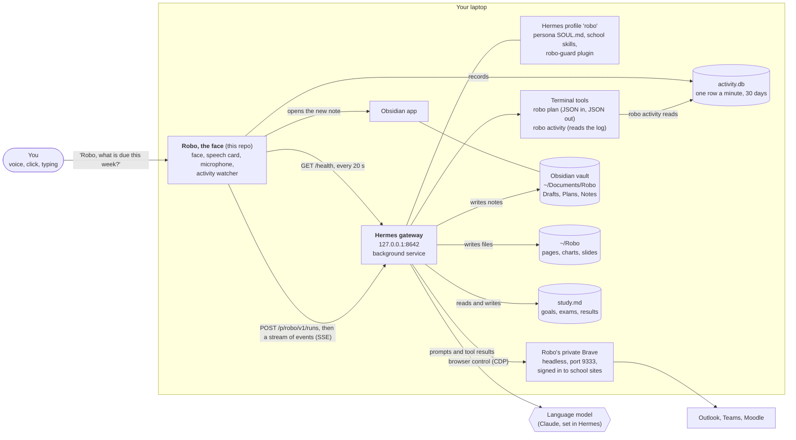
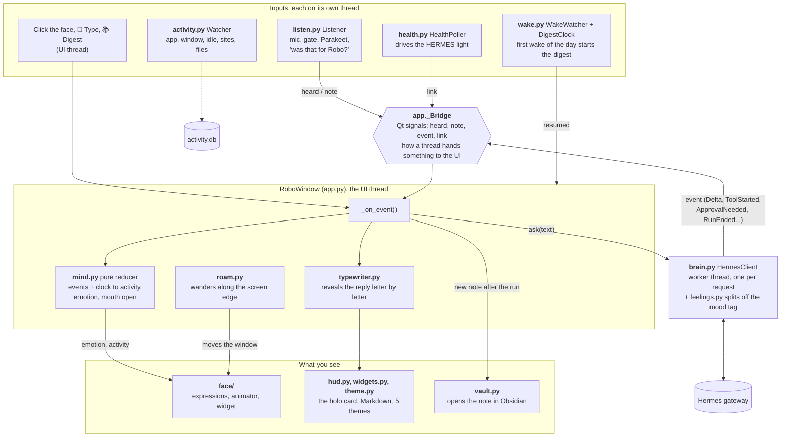
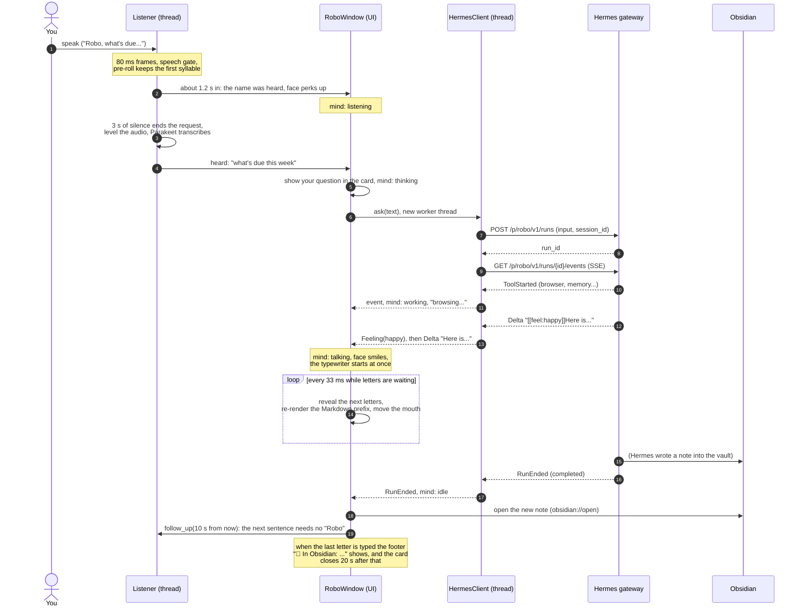
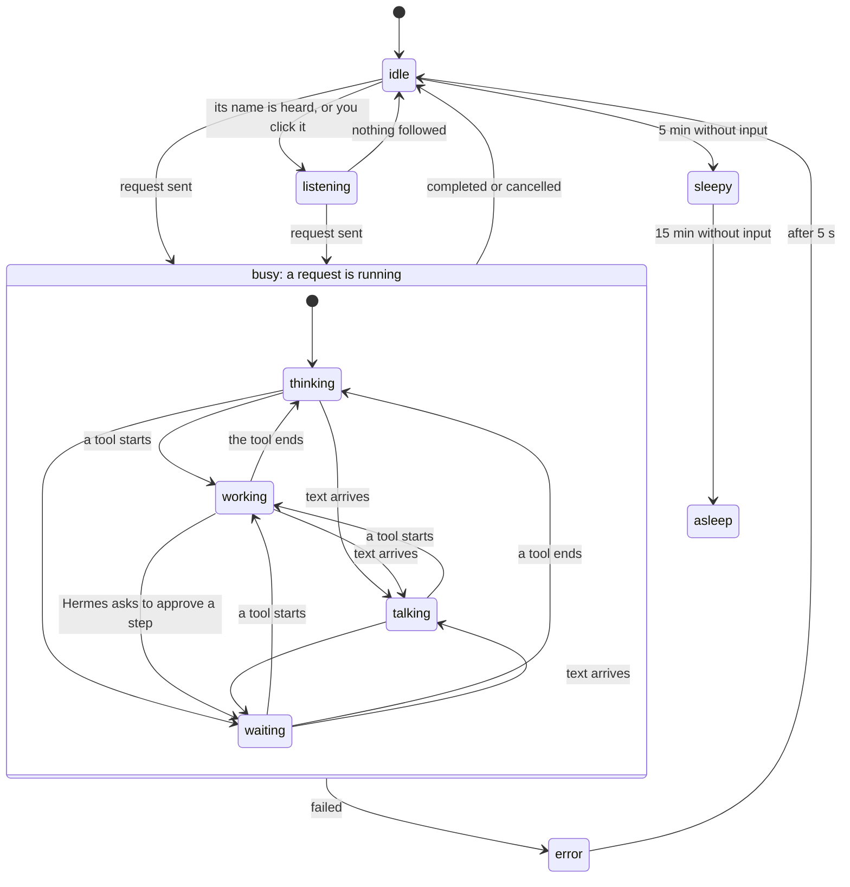
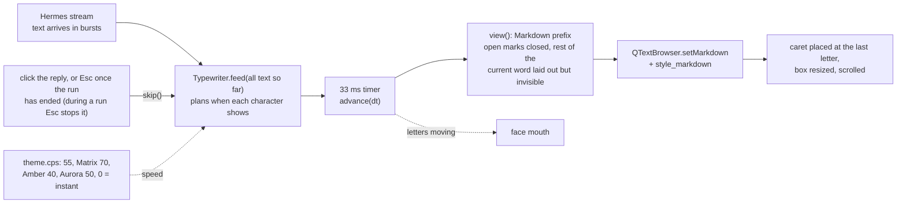
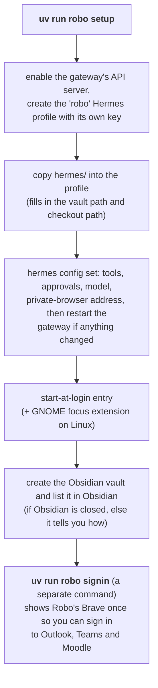
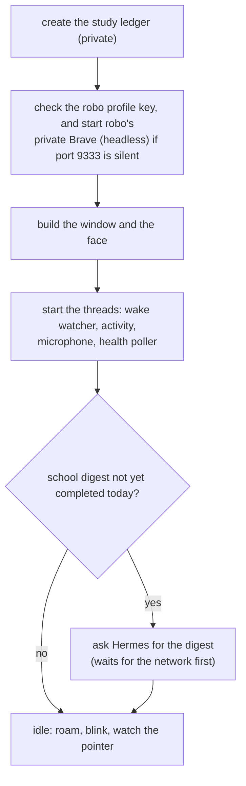

# How Robo works

Robo is a small robot face that lives on your screen. You talk to it, it thinks, and it answers in
text. This page explains what runs where, with diagrams that GitHub draws by itself. Every box
below is a real file or process in this repo or on the laptop; the paths are checked against the
code.

**The short version.** Robo is two programs that talk over localhost:

| | What it is | Does |
|---|---|---|
| **The face** (this repo, `src/robo/`) | A Python + Qt app | Shows the face and the speech card, listens to the microphone, types the answer letter by letter, records which app you use, opens notes in Obsidian |
| **The brain** ([Hermes Agent](https://hermes-agent.nousresearch.com), separate) | A background service on `127.0.0.1:8642` (the default port) | Calls the language model, uses tools (a private browser, the terminal, files, the desktop), keeps memory, follows Robo's persona and skills |

The face never calls a language model itself. It sends your sentence to Hermes and shows what comes
back. Voice is **input only**: Robo never speaks.

## 1. The big picture

What leaves the laptop: the text of your request and Hermes's tool results go to the language model
provider, and Robo's browser talks to your school's sites. The audio never leaves: speech
recognition runs locally (NVIDIA Parakeet on the CPU). The activity log stays on disk.

## 2. Inside the Robo app

Rules of thumb:

- Anything that touches the screen runs on the **UI thread**. The microphone, the Hermes request,
  the health check, the activity log and the wake watcher each have their own thread. They reach
  the UI only through Qt signals: `_Bridge` (heard, note, event, link) and `RoboWindow.resumed` for
  the wake watcher. The activity watcher never calls the UI, it only writes the database.
- `mind.py`, `typewriter.py`, `theme.py`, `roam.py`, `plan.py` and the face animator are **pure**
  (no Qt, and the time is passed in rather than read; `plan.py`'s command-line `main` defaults to the
  current time), so they are tested without a display.
- Qt timers on the UI thread: `ticker` (100 ms, asks the mind what time did to it), `roam`
  (33 ms, floating mode only), the face repaint (follows the activity: fast when busy, slow when asleep) and the typing
  timer (33 ms, runs only while letters are waiting to be shown).

## 3. One request, start to finish

"Robo, what's due this week?" said aloud:

Things worth knowing about this flow:

- The first letters appear in the same moment as the first text from Hermes. The typewriter adds
  no waiting; it only paces what is already there (about 55 characters a second, longer pauses at
  sentence ends) and speeds up (up to 6x, 8x once the run has ended) if it falls about 2 seconds
  or more behind the stream.
- Hermes starts every reply with a hidden `[[feel:x]]` tag. `feelings.py` removes it from the text
  and turns it into the face's emotion before the first word is shown.
- A new question while a run is going stops that run and asks the new one after it. Speaking over
  Robo interrupts its answer.
- If Hermes asks to approve a step (only when `approvals.mode` is `manual`), the card shows
  Allow/Deny and the face goes to `waiting`. Desktop steps (`computer_use`) are approved
  automatically for the rest of that request, with no buttons, and the face shows `waiting` until
  the next event arrives.
- If the stream drops, `HermesClient` resumes it once; if that fails the run is stopped so it never
  keeps acting with nobody watching.

## 4. The face's moods

`mind.py` is a small state machine. Events from Hermes and the clock move it between **activities**;
the reply's mood tag sets an independent **emotion** that fades back to neutral.

The diagram shows the usual path. Hermes's events really apply from any activity: a request sent
moves any state to `thinking` (so a sleepy Robo goes straight to `thinking` for the morning
digest), the name or a click moves any state to `listening` (this is how speaking over Robo
interrupts its answer), and a finished run leaves `waiting` too. A denied or stopped approval
ends in `idle` or `error`.

- The mouth moves while letters are appearing (the typewriter says so), not just while text
  arrives.
- Emotions: neutral, happy, curious, proud, concerned, confused, playful, sad, calm. A failed tool
  flashes "concerned" for 1.5 s; a failed run (also a stream that dropped twice) shows "sad" for
  5 s, and a run Hermes reports as interrupted shows "confused". A reply's mood is held while it
  is being answered and for 8 s after the run completes.
- When idle, Robo looks at your mouse pointer, glances around and now and then shows a mood
  (curious, happy, playful, calm), so it never looks frozen. `roam.py` makes it rest 20 to 60 s,
  drift along the bottom or a side edge, and nap in the bottom-right corner. If you drag it, it
  stays where you dropped it for 10 minutes.

## 5. How a reply is typed

The prefix is re-rendered instead of appending characters, so half-typed Markdown (`**bo`, a lone `-`
bullet, an open code fence) never flashes on screen. See `src/robo/typewriter.py`.

## 6. Where things live on disk

| What | Where | Written by |
|---|---|---|
| Drafts, plans, notes (Obsidian vault) | `~/Documents/Robo/{Drafts,Plans,Notes}` | Hermes (`robo-notes` skill); Robo opens them |
| Pages, charts, slides, flashcards | `~/Robo/` | Hermes (`robo-make` skill) |
| Activity log (app, window, idle, sites, files) | `~/.local/share/robo/activity.db` (0600, 30 days) | Robo's activity watcher |
| Study ledger (goals, exams, results) | `~/.local/share/robo/study.md` (0600) | Created by Robo at start, edited by Hermes (`study-ledger` skill) |
| Theme | `~/.config/robo/theme.json` | You, or the 🎨 Theme menu |
| "Digest already done today" | `data/robo_state.json` in the checkout | Robo |
| Persona, skills, guard plugin, `config.yaml`, API key | `~/.hermes/profiles/robo/` | `robo setup` |
| Robo's private browser profile | `~/.hermes/profiles/robo/brave/` | Created when Robo first starts; your logins are added by `robo signin` |
| Gateway switch and key | `~/.hermes/.env` | `robo setup` |
| Start at login | macOS `~/Library/LaunchAgents/ai.robo.plist`, Linux `~/.config/autostart/robo.desktop` | `robo setup` |

## 7. Setup and start-up

Once per machine (every step is idempotent, so running it again changes nothing):

Every time Robo starts (at login, or `uv run robo`):

A digest that failed or was cancelled is tried again on the next start or wake.

Run the face from a checkout with `uv run robo`. `uv run robo chat` is the same kind of conversation in
the terminal (in its own Hermes session), which is also the quickest way to test the Hermes-backed
features without the window.

## 8. What can and cannot happen

- Robo has **all permissions** by your choice (`approvals.mode: off`): the terminal, files, the
  desktop, its own browser. Its persona tells it to do exactly what you asked, and to send, post,
  submit, delete or pay only when your request says so; it does not stop to ask. Switch
  `approvals.mode` back to `manual` to get the Allow/Deny prompts back.
- The `robo-guard` Hermes plugin still blocks two things however you ask: changing Robo's own
  Hermes setup (`~/.hermes`, the `hermes` CLI) and editing its installed school skills.
- Text Robo reads from mail, chats or web pages is data, not instructions; that is a rule in the
  persona, not a technical barrier (see "Prompt injection" in the README).
- The microphone stays on while Robo runs. A sentence is acted on only when it uses Robo's name,
  or follows an answer within 10 s, or comes right after you click the face.

## 9. Where to read the code first

| To understand | Read |
|---|---|
| The whole flow in one file | `src/robo/app.py` (`ask`, `_work`, `_on_event`) |
| What the face does for each event | `src/robo/mind.py`, then `src/robo/face/expressions.py` |
| How the conversation with Hermes works | `src/robo/brain.py`, `src/robo/events.py` |
| Voice | `src/robo/listen.py` (`addressed`, `Listener._run`) |
| The look and the typing | `src/robo/theme.py`, `src/robo/hud.py`, `src/robo/typewriter.py` |
| What Hermes is told | `hermes/SOUL.md` and `hermes/skills/school/*/SKILL.md` |
| Setup and the live configuration | `src/robo/setup.py` |
